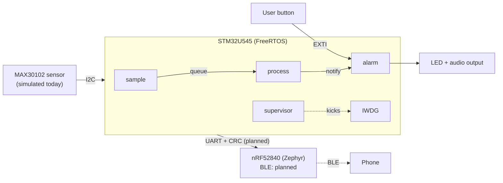

# Vital: FreeRTOS Pulse Oximeter


A safety-oriented pulse oximeter firmware on the **STM32U545** (Cortex-M33) running **FreeRTOS**, developed with a lightweight version of the practices used for medical device and avionics software: numbered requirements, traceability to code and tests, unit tests in CI, a watchdog supervisor with a defined safe state, and repeatable fault injection.

The full pipeline (sampling, signal processing, alarms, and fault handling) runs today against a synthetic PPG signal model, so every behavior can be tested with a known correct answer. The MAX30102 optical sensor plugs in behind the same interface.

> **Disclaimer:** This is not a medical device, is not calibrated, and must not be used for diagnosis or patient monitoring.

---

## Demo

<!-- Replace with your video or GIF. GitHub plays .mp4 files dragged into the README editor. -->
**[Demo video: 90 seconds]**

1. Normal readings: `HR 72 BPM | SpO2 97.8%`
2. `sim spo2 85` → physiological alarm (fast blink) with measured response latency
3. User button → audio paused for 2 minutes, visual alarm stays on
4. `sim finger off` → technical alarm (slow blink) within 1 s
5. `fault hang sample` → supervisor detects the hung task, enters the safe state, watchdog resets, fault reported on reboot

<!--  -->

---

## Highlights

- **6 static FreeRTOS tasks** with rate-based priorities; no dynamic allocation after startup
- **Heart rate and SpO2 algorithm** in hardware-independent C: DC tracking, beat detection with an adaptive threshold, ratio-of-ratios SpO2, finger and signal-quality detection
- **Alarm system** modeled on IEC 60601-1-8 concepts: physiological vs. technical alarms with distinct indications, priority, hysteresis, a 2-minute audio pause, and configurable limits with safety bounds
- **Watchdog supervisor**: every task checks in through an event group; a missed check-in triggers the safe state within 500 ms (worst case), backed by the hardware IWDG
- **Fault record that survives reset** (`.noinit` RAM) and is reported on the next boot
- **Fault injection from the CLI**: hang any task, including the supervisor, on demand
- **44 unit tests** on the host, named by requirement ID, run with coverage in GitHub Actions alongside a full firmware build

---

## Architecture



**Safety partitioning:** all safety-relevant functions (sensing, processing, alarms, supervision) run on the STM32. The planned nRF52840 handles wireless only, so a radio failure cannot affect alarm behavior (REQ-COM-03).

### Tasks

All tasks are created with static allocation. Scheduling is preemptive: the highest-priority ready task always runs.

| Priority | Task | Trigger | Responsibility | Rationale |
|:---:|---|---|---|---|
| 6 | `supervisor` | Every 250 ms | Checks all task check-ins, kicks the IWDG, enters the safe state on a miss | Must preempt everything to detect any hung task, including the alarm task |
| 5 | `alarm` | Notification from `process`, button interrupt, 25 ms tick | Evaluates limits, drives the alarm outputs, handles audio pause | Safety output must never wait behind data processing |
| 4 | `sample` | Every 10 ms (`vTaskDelayUntil`) | Reads the sensor, queues the sample | Strict 100 Hz timing; a late sample distorts the signal |
| 3 | `process` | Sample queue | Filtering, beat detection, HR and SpO2, publishes vitals | Variable workload; the 32-sample queue absorbs jitter |
| 2 | `heartbeat` | Every 5 s | Prints stack high-water marks | Diagnostics only |
| 1 | `cli` | UART stream buffer | Parses and runs commands | Human-speed input |

### Inter-task communication

| Mechanism | From → To | Purpose |
|---|---|---|
| Queue (32 samples) | `sample` → `process` | Decouples strict sampling from variable processing |
| Task notification | `process`, EXTI13 ISR → `alarm` | Immediate wake-up on new vitals or a button press |
| Stream buffer | USART1 ISR → `cli` | Moves received bytes out of interrupt context |
| Event group | monitored tasks → `supervisor` | Watchdog check-ins |
| Mutex | any task → UART | Prevents interleaved log output |

### Interrupt priorities

Interrupts that call FreeRTOS APIs (USART1, EXTI13) run at NVIC priority 6, below `configMAX_SYSCALL_INTERRUPT_PRIORITY` (5). Interrupt handlers do the minimum and defer work to tasks.

---

## Signal processing

Implemented in `ppg.c` as pure C (no RTOS or HAL), so the same code runs on the target and in host unit tests.

1. **DC tracking:** 1.5 s exponential average; re-acquires immediately on a large level jump (finger placed or removed)
2. **Noise smoothing:** ~5 Hz low-pass
3. **Finger detection:** IR level below threshold means ambient light only
4. **Beat detection:** inverted AC signal against 50% of a decaying envelope, which rejects the dicrotic wave; 200 ms refractory period
5. **SpO2:** per-beat ratio of ratios, `SpO2 = 110 − 25 × (AC_red/DC_red)/(AC_ir/DC_ir)` (uncalibrated empirical approximation)
6. **Validity:** 4 regular beats, perfusion ≥ 0.1%, HR within 30–240 BPM; no beat for 2.5 s resets

Very low SpO2 values are deliberately **not** marked invalid, because the low-SpO2 alarm must see them (see Problems below).

---

## Alarms

| Condition | Type | Default | Indication |
|---|---|---|---|
| SpO2 low | Physiological | < 90% (clears at ≥ 91%) | Fast blink (4 Hz) + audio |
| HR low / high | Physiological | < 50 / > 120 BPM (±2 BPM hysteresis) | Fast blink + audio |
| No finger | Technical | Immediate | Slow blink (0.5 Hz) + audio |
| Signal lost | Technical | Finger on, no valid reading for 10 s | Slow blink + audio |

- Physiological alarms take priority over technical ones.
- If the signal becomes noisy during a physiological alarm, the alarm is **held**: noise does not declare a patient fine. Removing the finger clears physiological alarms and raises a technical one.
- The user button pauses audio for 2 minutes; the visual alarm remains. Pausing is ignored when no alarm is active.
- Limits are configurable from the CLI; unsafe or inconsistent limits are rejected by the alarm module itself.
- Alarm outputs are tested for 1 s at startup.

---

## Fault handling

| Injected fault | Detected by | Detection time | Response |
|---|---|---|---|
| `fault hang sample` / `process` / `cli` / `alarm` | Supervisor (missed check-in) | ≤ 500 ms (design worst case) | Safe state: fault recorded, alarm output on, IWDG reset, fault reported on reboot |
| `fault hang supervisor` | Hardware IWDG | ~1 s | Reset; boot reports "watchdog reset, no fault record" |
| Stack overflow (undersized stack) | FreeRTOS overflow check (method 2) | At next context switch | Safe state with task name |
| Heap exhaustion | Malloc-failed hook | Immediate | Safe state |
| Finger removed | Algorithm + immediate publish | < 1 s | Technical alarm |
| Pulse lost, finger on | Algorithm validity checks | ≤ 3 s invalid; 10 s to technical alarm | Readings marked invalid, then technical alarm |

<!-- Add measured values from the logic analyzer here once captured. -->

**Watchdog design rule:** every monitored task must check in at least once per 250 ms window, and no monitored task may block for more than 100 ms in a single wait, including during startup.

---

## Verification

- **Requirements:** [`docs/requirements.md`](docs/requirements.md): numbered, testable requirements with verification methods (Test, Demonstration, Inspection, Analysis) and a traceability table
- **Unit tests:** 44 tests (Unity) on the host: 20 for the algorithm, 24 for alarm logic, including end-to-end tests from signal model to alarm. Test names carry requirement IDs, e.g. `test_REQ_ALM_01_low_spo2_alarms_on_first_reading`
- **Coverage:** `alarm.c` 100%, `ppg.c` 98% line coverage (gcovr report published by CI)
- **CI:** every push runs the host tests with coverage and builds the firmware with the ARM toolchain
- **Strict compilation:** algorithm and alarm modules compile cleanly with `-Wall -Wextra -Wconversion -Wdouble-promotion`

Traceability works by search: a requirement ID finds its implementation (`/* Implements: REQ-ALM-01 */`) and its tests.

---

## Problems I hit

**Watchdog boot loop from a task waiting "forever."** After adding the supervisor, the board reset every 511 ms. The fault record named the CLI task: it waited for keyboard input with `portMAX_DELAY`, so it could not check in. A task legitimately waiting looks identical to a hung task. Fixed with a 100 ms timeout, and the lesson became the watchdog design rule above. The rule caught a second instance later: the alarm task's 1 s startup self-test.

**UART commands losing bytes.** Commands sent as a single burst lost characters. Error counters showed the cause, and enabling the USART RX FIFO and raising the system clock from 4 MHz to 160 MHz removed the problem.

**Bytes stuck in the UART FIFO.** After enabling the FIFO, the last bytes of each command (the Enter) arrived only when the next input came in, with all error counters at zero. Nothing was lost, so the bytes had to be waiting somewhere. With a 1/8 FIFO threshold, the HAL used the "threshold reached" interrupt for 1-byte receives, which does not fire again while bytes remain. Raising the threshold made the HAL use the level-triggered "FIFO not empty" interrupt.

**Silent loss of UART reception.** A failed interrupt re-arm could permanently stop reception. Added counters for errors, re-arm failures, and restarts, plus task-level recovery that restarts reception if it has stopped.

**A safety bug caught by a test.** The first algorithm marked SpO2 below 70% as invalid, since accuracy is specified for 70–100%. A test at 70% failed, which exposed the real problem: the low-SpO2 alarm would never fire when the patient is in the most danger. Very low values now stay valid, and a dedicated test prevents regressions.

**A requirement gap found by tracing end to end.** The algorithm detected finger removal within 1 s, but vitals were published once per second, so the alarm could see it up to 2 s later, violating REQ-FLT-02. Vitals are now also published immediately when finger or validity state changes.

<!-- Add your own: e.g. the CMake float printf flag, BSP-owned peripherals, the EXTI handle mismatch. -->

---

## Building

**Firmware** (requires the Arm GNU toolchain, CMake, and Ninja; STM32CubeCLT provides all three):

```bash
cd firmware/u545
cmake --preset Debug
cmake --build --preset Debug
```

Build options: `VITAL_USE_SIM_SENSOR` (default ON) and `VITAL_FAULT_INJECTION` (default ON; turn off for a production-style build).

**Host unit tests** (requires a host C compiler):

```bash
cd firmware/u545
cmake -S test -B build-test -G Ninja -DVITAL_COVERAGE=ON
cmake --build build-test
ctest --test-dir build-test --output-on-failure
```

---

## CLI reference

Serial: ST-LINK virtual COM port, 115200 8N1, CRLF line endings.

| Command | Description |
|---|---|
| `help` | List commands |
| `stats` | Uptime, dropped samples, stack usage, UART counters, CPU clock |
| `log on` / `log off` | Periodic output |
| `sim hr <bpm>` / `spo2 <pct>` / `finger on\|off` / `perf <pct>` / `noise <counts>` | Simulator inputs |
| `alarm` | Show limits and alarm state |
| `alarm spo2 <pct>` / `alarm hr <low> <high>` | Set limits (validated) |
| `alarm pause` | Same as pressing the button |
| `fault hang <sample\|process\|cli\|alarm\|supervisor>` | Fault injection |

---

## Repository layout

```
docs/requirements.md        Requirements, verification methods, traceability
firmware/u545/
  App/Src/ppg.c             HR/SpO2 algorithm (pure C)
  App/Src/alarm.c           Alarm decision logic (pure C)
  App/Src/ppg_model.c       Synthetic PPG signal model (shared by simulator and tests)
  App/Src/app_tasks.c       Sampling and processing tasks
  App/Src/alarm_task.c      Alarm task, outputs, button
  App/Src/watchdog.c        Supervisor and check-ins
  App/Src/fault.c           Safe state and persistent fault record
  App/Src/cli.c             Interrupt-driven UART command line
  App/Src/sensor_sim.c      Simulated sensor behind sensor.h
  test/                     Unity unit tests
  Core/, Drivers/           STM32CubeMX-generated code
.github/workflows/ci.yml    CI: host tests + coverage, firmware build
```

---

## Hardware

- NUCLEO-U545RE-Q (STM32U545, Cortex-M33, 160 MHz)
- MAX30102 pulse oximetry sensor (integration in progress)
- nRF52840 DK (planned BLE coprocessor) and nRF52840 dongle (BLE sniffer)

---

## Roadmap

- [x] FreeRTOS bring-up, static allocation, overflow detection
- [x] Requirements with verification methods and traceability
- [x] Sensor abstraction and signal simulator
- [x] Interrupt-driven CLI
- [x] Watchdog supervisor, safe state, persistent fault record, fault injection
- [x] HR/SpO2 algorithm with unit tests and CI
- [x] Alarm system with button pause and configurable limits
- [ ] MAX30102 driver and validation against a real finger
- [ ] Logic analyzer measurement of alarm and fault detection latency
- [ ] Static analysis (cppcheck MISRA addon) in CI; dynamic allocation disabled
- [ ] Low power: tickless idle and Stop mode, measured current
- [ ] BLE coprocessor (nRF52840, Zephyr) with standard Heart Rate and Pulse Oximeter services

---

## Reference standards

Process and structure are loosely modeled on the following. Formal compliance is not claimed.

- IEC 62304: Medical device software life cycle processes
- IEC 60601-1-8: Alarm systems in medical electrical equipment
- ISO 80601-2-61: Pulse oximeter equipment

## License

MIT